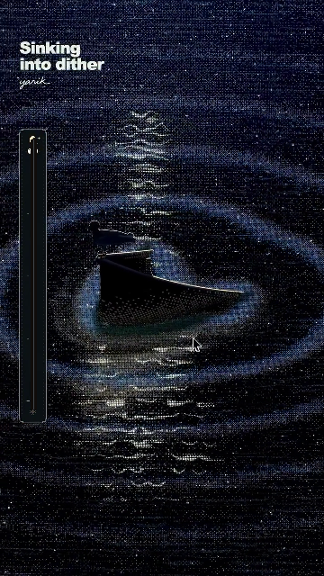
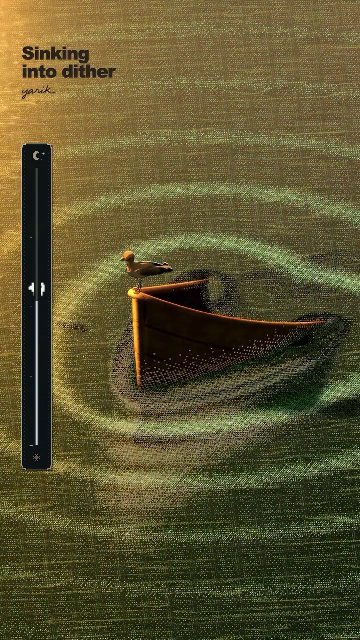

# River

<p align="center">
  
</p>

<p align="center">
  <strong>A dark, cinematic, offline-first media library and desktop video player for Windows.</strong>
</p>

<p align="center">
  <a href="https://github.com/alnexi/Movie-time"></a>
  <a href="https://dotnet.microsoft.com/"></a>
  <a href="https://learn.microsoft.com/en-us/windows/apps/winui/winui3/"></a>
  <a href="https://github.com/alnexi/Movie-time/releases"></a>
  <a href="https://github.com/alnexi/Movie-time"></a>
  <a href="LICENSE"></a>
</p>

---

## What is River?

**River** is a native Windows application built for movie and television lovers who curate their own media collections on local hard drives and network storage. It combines the visual elegance of a premium streaming service with the independence, speed, and privacy of a standalone desktop player.

Everything in River runs 100% locally. There are no cloud accounts, no subscription paywalls, no tracking telemetry, and no third-party web scrapers altering your files. Your files remain untouched, and your watch history stays entirely on your computer in a local SQLite database.

<p align="center">
  
</p>

---

## Key Features

### 1. Local-First & Privacy-Focused
- **Zero Cloud Dependencies**: Operates entirely offline without internet connectivity.
- **Local SQLite Database**: Stores all metadata, collections, playlists, and resume progress in an embedded, high-performance WAL-mode SQLite database located at `%LocalAppData%\MovieTime`.
- **Absolute Data Safety**: River never moves, renames, deletes, or modifies your media files during indexing or playback. Removing a folder or library unregisters it from the database without touching the physical files on disk.

### 2. Dark Cinematic Visual Identity
- **Liquid Glass Design System**: Deep translucent acrylic surfaces, subtle specular rim lighting, and chromatic dispersion gradients engineered specifically for dark room viewing.
- **Ambient Billboard Hero Banner**: Edge-to-edge cinematic banner with smooth vignette shading highlighting featured and recently added titles.
- **Dynamic Content Shelves**: Horizontal rows for "Continue Watching" (with instant resume position bars) and "Recently Added" titles.
- **Theatrical Poster Grid**: Standard 2:3 vertical aspect ratio cards with smooth hover scaling, selection glow, and technical quality badges (`4K HDR`, `1080p HD`).
- **Quick-Action Dialogs**: Instant play or inspect options directly from poster cards without disruptive full-screen page transitions.

### 3. Native Embedded Video Player
- **LibVLC Engine with Hardware Decoding**: Built directly on native LibVLC 3.0.24 via LibVLCSharp, providing smooth, hardware-accelerated playback for virtually every container and codec (`MKV`, `MP4`, `AVI`, `MOV`, `HEVC/H.265`, `H.264`, `AV1`, `VP9`, `10-bit HDR`).
- **Single-Window Integration**: Plays seamlessly inside River's main interface—no detached player windows or third-party background executables.
- **Liquid Glass Player HUD**: Clean, auto-hiding controls (3.5-second inactivity timeout) featuring a draggable timeline scrubber, elapsed/remaining time indicators, and media stream information.
- **Comprehensive Audio & Subtitle Control**:
  - Switch between embedded audio streams or attach external audio files (`.mka`, `.aac`, `.mp3`) with `±100ms` sync adjustment.
  - Switch embedded subtitle tracks or load external subtitle files (`.srt`, `.ass`, `.ssa`, `.vtt`, `.sub`).
  - Customizable subtitle appearance: adjustable font size (22pt to 52pt), high-contrast colors (White, Yellow, Cyan, Green), and outline thickness.
- **Volume Boost & Speed Tuning**: Clean volume slider with up to 200% software amplification and speed control from 0.1x to 2.0x in 0.1x steps.
- **Full Keyboard Control**:
  - `Space` / `K`: Play / Pause
  - `J` / `L`: Seek backward / forward 10 seconds
  - `Left` / `Right`: Seek backward / forward 5 seconds
  - `0`–`9`: Jump to 0%–90% of video duration
  - `Up` / `Down`: Adjust volume in 5% steps
  - `M`: Mute / Unmute
  - `[` / `]`: Decrease / increase playback speed by 0.1x
  - `F` / `Alt+Enter`: Toggle edge-to-edge fullscreen
  - `Esc`: Exit player and return to media details

### 4. Smart Library Management (`MLibrary`)
- **Multi-Drive Architecture**: Automatically enumerates all available internal and external drives (`C:`, `D:`, `E:`) and organizes media into isolated `MLibrary` root directories (e.g., `D:\MLibrary`).
- **Live Background Auto-Sync**: Uses a 64KB-buffer `FileSystemWatcher` combined with a 2-second debouncing queue to detect added, removed, or modified media in real time, updating the UI instantly without manual refreshes.
- **Missing Media Reconciliation**: Intelligently identifies relocated or renamed files by matching size and timestamp signatures, preserving entity relationships, watch history, and resume checkpoints. Temporarily missing files (e.g., from an unplugged external hard drive) are hidden safely without triggering mass database deletions.

### 5. Movies & TV Shows Organization
- **Heuristic Filename Parser**: Deterministically recognizes scene releases, standard episode naming (`S01E08`, `1x08`, `Season 1 Episode 8`), multi-episode packages (`S01E08E09`), special features, and technical tags (`REMUX`, `BluRay`, `x265`, `HDR`).
- **Hierarchical TV Navigation**: Dedicated TV Shows section with series overviews, interactive season tabs, and 16:9 episode cards featuring durations, quality badges, and thumbnail previews.
- **Multi-Cut Support**: Handles multiple local video files for the same title (e.g., Theatrical vs. Director's Cut) and lets you choose your preferred version directly from the details view.

### 6. Interactive Pixel-Art Theme Experience
- **Handcrafted Boat Scene**: Features an authentic retro pixel-art wooden sailboat bobbing on water with an interactive seagull.
- **Continuous 0%–100% Celestial Transition**: Slide dynamically between Day, Twilight, and Night themes. The water, sky, reflections, and palette shift in real time with 8x8 Bayer ordered dithering and mouse-reactive parallax depth.

<p align="center">
  
  &nbsp;&nbsp;
  
</p>

### 7. Windows Integration
- **Universal "Open With"**: Registered in Windows Explorer's "Open With" menu for 20+ video extensions. Right-click any video file on your computer to open it directly in River.
- **Single-Instance Routing**: Opening a video externally sends the file directly to your existing River window without starting duplicate processes.
- **Native Shortcuts & Uninstaller**: Installs clean Start Menu and Desktop shortcuts and registers cleanly in Windows *Installed apps* (*Add or remove programs*).

---

## Installation

### Download Official Release

The easiest way to install River is using the standalone all-in-one setup executable:

👉 **[Download River-Setup-x64.exe](https://github.com/alnexi/Movie-time/releases/latest)**

### Premium All-in-One Installer
River includes its own custom-built installer matching the application's signature dark Liquid Glass aesthetic:
- **100% Offline**: Embeds the .NET 10 runtime, Windows App SDK / WinUI 3 binaries, native LibVLC 3.0.24 codecs, and SQLite engine. No external downloads or internet connections are required.
- **Express or Custom Setup**: Install to `%ProgramFiles%\River` with one click or choose a custom target directory.
- **Safe Uninstallation**: Includes a dedicated uninstaller (`Uninstall.exe`) that cleanly removes application binaries and shortcuts while **strictly preserving your personal database, settings, and media files**.

### System Requirements
- **Operating System**: Windows 10 Version 1809 (Build 17763) or higher, or Windows 11.
- **Architecture**: 64-bit (x64) processor.
- **Permissions**: Administrator privileges during installation (to write to `Program Files` and register file associations).

---

## How River Works

```
┌─────────────────────────────────────────────────────────────┐
│                     River (WinUI 3 XAML)                    │
│   HomeView  •  MoviesView  •  TvShowsView  •  PlayerView    │
├─────────────────────────────────────────────────────────────┤
│                     Presentation Layer                      │
│     CommunityToolkit.Mvvm ViewModels & Services             │
├─────────────────────────────────────────────────────────────┤
│                      Core Engine Layer                      │
│   • FilenameParserEngine    • MediaScannerService           │
│   • LibraryAutoSyncService  • MediaRemovalService           │
│   • VlcPlayerService        • ThemeManagerService           │
├─────────────────────────────────────────────────────────────┤
│                     Data & Media Storage                    │
│   • Local SQLite Database (%LocalAppData%\MovieTime)        │
│   • Local Drives & MLibrary Storage Folders (D:\MLibrary)   │
│   • Native Embedded LibVLC 3.0.24 (DirectX/HW-Accelerated)  │
└─────────────────────────────────────────────────────────────┘
```

River uses a decoupled architecture:
1. **`MovieTime.App`**: The user interface layer built on **WinUI 3** and the **Windows App SDK**. Handles presentation models, animations, XAML layouts, and Windows Shell integration.
2. **`MovieTime.Core`**: Platform-agnostic engine containing domain entities, parsing heuristics, the SQLite WAL database repository, filesystem scanning, and synchronization logic.
3. **`MovieTime.Installer`**: Standalone .NET 10 WPF single-file setup wizard with embedded offline payload decompression, Windows COM shortcut creation, and registry management.
4. **`MovieTime.Tests`**: Automated test suite containing 351 unit and integration tests verifying parsers, database migrations, theme math, installer payloads, and library safety.

---

## Building from Source

If you prefer to build River yourself from source:

### Prerequisites
- Windows 10 (1809+) or Windows 11 (x64).
- [.NET 10 SDK](https://dotnet.microsoft.com/download/dotnet/10.0) (x64).
- Visual Studio 2022 / 2026 or Visual Studio Code with the C# Dev Kit and Windows App SDK build tools.

### 1. Clone the Repository
```powershell
git clone https://github.com/alnexi/Movie-time.git
cd Movie-time
```

### 2. Build the Solution
```powershell
# Build all projects in Release x64 configuration
dotnet build MovieTime.sln -p:Platform=x64 --configuration Release
```

### 3. Run the Automated Tests
```powershell
dotnet test MovieTime.sln -p:Platform=x64 --configuration Release
```

### 4. Run River Directly
```powershell
dotnet run --project src\MovieTime.App\MovieTime.App.csproj -p:Platform=x64
```

### 5. Build the Standalone Installer
To package the standalone `River-Setup-x64.exe` installer with all dependencies embedded:
```powershell
powershell -ExecutionPolicy Bypass -File .\build-installer.ps1
```
The compiled installer will be validated, verified against SHA-256 checksums, and output to your desktop under `River Installer\River-Setup-x64.exe`.

---

## Project Status & Limitations

- **Current Version**: `v1.2.2` (Stable Official Release).
- **Maintenance**: Actively maintained.
- **Hardware Platform**: River is built specifically for 64-bit (`x64`) Windows. 32-bit (x86) and ARM64 architectures are not currently supported.
- **Storage Model**: River is designed exclusively for local and network-attached storage. It intentionally does not provide cloud synchronization or account login.

---

## Credits & Author

River is created, architected, and maintained by:

**Ali Nematollahi**  
GitHub: [@alnexi](https://github.com/alnexi)  
Email: [ali_nematollahi@icloud.com]
Repository: [https://github.com/alnexi/Movie-time](https://github.com/alnexi/Movie-time)

---

## License

This project is licensed under the [MIT License](LICENSE).
